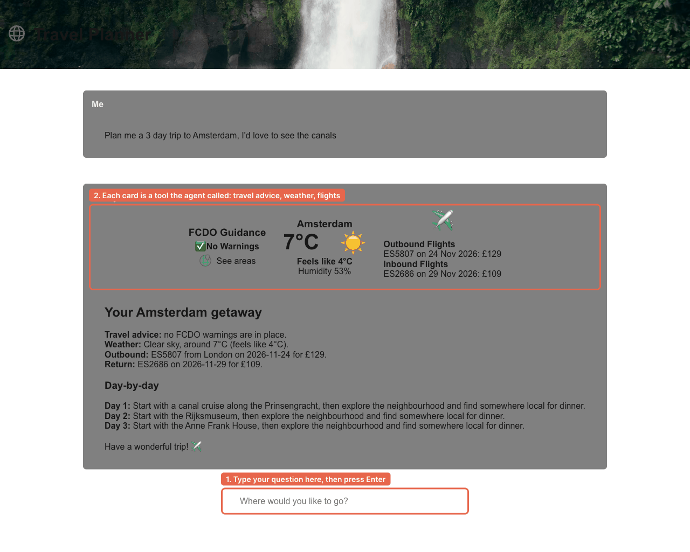

# LLM observability 101: observing an AI agent with OpenTelemetry and Elastic

A 40-minute hands-on workshop. You'll run an AI travel-planning agent on your laptop, follow its LLM and tool calls through traces, turn vendor-specific telemetry into the [OpenTelemetry GenAI semantic conventions](https://opentelemetry.io/docs/specs/semconv/gen-ai/), make its guardrails and evaluations observable, and leave with a dashboard and an alert.

Everything runs locally in Docker: Elasticsearch and Kibana 9.5, the upstream OpenTelemetry Collector, Prometheus, and the agent itself. There's no cloud account or LLM key to sign up for, and Elasticsearch runs on its free Basic license, so nothing expires after the workshop.

```
 browser ─► travel planner (Next.js, Vercel AI SDK, OpenTelemetry JS SDK)
              │  OTLP: traces, logs and evaluation events
              ▼
        OpenTelemetry Collector (contrib) ──────────────────────────► Elasticsearch 9.5 ◄── Kibana 9.5
          gen_ai_normalizer: vendor attributes → GenAI semconv               ▲
          signal_to_metrics: spans → gen_ai.client.token.usage …             │ remote write
              │  :8889 Prometheus exporter ◄── scrape ── Prometheus ─────────┘
              ▼
        LLM: the offline mock (default), Ollama on your laptop, or any OpenAI-compatible endpoint
        Tools: flights (Elasticsearch), weather (Open-Meteo), UK travel advice (GOV.UK)
```

## Before the workshop (20-30 minutes, on good wifi)

These steps assume a Mac with Docker Desktop. Linux and Windows work too:

| Your laptop | Install | Notes |
|---|---|---|
| **Mac** | [Docker Desktop](https://www.docker.com/products/docker-desktop/), and `xcode-select --install` for `git` and `make` | Can't use Docker Desktop? Use [Podman](#using-podman-instead-of-docker) |
| **Linux** | Docker Engine with the Compose plugin (`docker compose version` should work), plus `git`, `make` and `curl` | Add yourself to the `docker` group so you don't need `sudo`. Podman also works |
| **Windows** | Docker Desktop with the WSL 2 backend, and an Ubuntu WSL 2 terminal with `sudo apt install git make curl` | Run every command in the WSL terminal, and clone into your WSL home directory (`~`), not `C:\` or `/mnt/c` |

Give Docker at least **6 GB of memory** (8 GB is better) and keep 10 GB of disk free. Close other heavy containers or Kubernetes clusters before you start. You don't need Node.js: everything runs in containers.

Then:

```bash
git clone https://github.com/ericmustin/observing-ai-agents.git
cd observing-ai-agents/workshop
make prep      # creates .env, downloads the images (about 7 GB on disk) and builds the app
make up        # starts everything (1-3 minutes)
make doctor    # checks every part of the stack
```

When `make doctor` says **All good**, you're ready. `make down` stops everything until the day. Your data is kept.

### Using Podman instead of Docker

1. Install [Podman Desktop](https://podman-desktop.io/) (or `brew install podman`), and Docker Compose (`brew install docker-compose`, or let Podman Desktop install it during set-up). `podman compose` runs it for you.
2. Give the Podman machine 8 GB of memory: `podman machine init --memory 8192 --cpus 4`, then `podman machine start`. For an existing machine, stop it and run `podman machine set --memory 8192`. On Linux there's no machine: run `systemctl --user enable --now podman.socket` instead.
3. Follow the steps above. If Podman is your only container engine, the Makefile uses it automatically. If Docker is installed too, run `cp .env.example .env` first and uncomment `CONTAINER_ENGINE=podman` in `.env`.

Wherever these docs say `docker compose`, type `podman compose`. Use the default mock LLM.

## On the day

1. `make up`, then `make doctor`.
2. The agent uses `LLM_MODE=mock` by default: a bundled offline model that behaves like a real one, tool calls and token counts included. It works with the wifi off, and every lab works with it. If you'd rather use a real model, see [LLM options](#llm-options).

3. Open:

   | What | Where |
   |---|---|
   | Travel planner | <http://localhost:3000> |
   | Kibana | <http://localhost:5601>, user `elastic`, password `changeme` |
   | Prometheus | <http://localhost:9090> |

   The travel planner looks like this. Type a question in the box at the bottom:

   

## The labs

Work in pairs: the **driver** types and the **navigator** reads the lab and keeps time. Swap after each lab.

| | Lab | Time | You'll leave with |
|---|---|---|---|
| 1 | [See what your agent does](labs/lab1-traces.md) | 8 min | A trace of every LLM and tool call |
| 2 | [Normalize and measure](labs/lab2-semconv.md) | 9 min | GenAI semconv data, token and latency metrics derived from spans |
| 3 | [Guardrails and evaluations](labs/lab3-guardrails.md) | 10 min | Guardrail and LLM-as-a-judge results you can see |
| 4 | [Keep it](labs/lab4-keep.md) | 6 min | A token-budget alert and a dashboard to take home |

To follow along on your own screen, open the slides ([PDF](slides/llm-o11y-101-workshop.pdf) or [PowerPoint](slides/llm-o11y-101-workshop.pptx)): after each lab's card, a slide for every step shows a screenshot of where to type or click, with the instructions beside it. The lab pages above have the full detail.

Copy-paste queries for every lab are in [`queries/README.md`](queries/README.md). If you fall behind, `make solution LAB=2` (or `LAB=3`) applies a lab's answer so you can carry on.

## LLM options

The app talks to any OpenAI-compatible chat completions endpoint. Pick one in `.env`, then run `make up` and `make doctor`.

**Not sure? Keep the mock.** It works on every laptop, with or without wifi, and the labs are built around it. Ollama is an optional extra for Macs running Docker Desktop. On Linux, Windows or Podman, use the mock.

| Option | Cost | Set-up | `.env` |
|---|---|---|---|
| **Mock** (default) | Free | None | `LLM_MODE=mock` |
| **Ollama**, a real model on your Mac | Free | Install [Ollama](https://ollama.com/download), then `ollama pull qwen3:1.7b` (1.4 GB) **before** the workshop | `LLM_MODE=live`<br>`LLM_BASE_URL=http://host.docker.internal:11434/v1`<br>`LLM_API_KEY=ollama`<br>`LLM_MODEL=qwen3:1.7b` |
| **Your instructor's endpoint** | Free to you | Your instructor gives you a URL and a key | `LLM_MODE=live`<br>`LLM_BASE_URL=https://…/v1`<br>`LLM_API_KEY=sk-…`<br>`LLM_MODEL=gpt-4o-mini` |
| **Any other OpenAI-compatible API** (OpenAI, a LiteLLM proxy, a free hosted tier) | Depends | A key | `LLM_MODE=live` plus that provider's base URL, key and model |

Notes on Ollama:

- Run the Ollama app **natively**, not in Docker: only the native app can use the Mac's GPU. The workshop reaches it through `host.docker.internal`.
- Use `qwen3:1.7b`. It's the small model that handled the agent's tool calls best in our tests: it usually calls all three tools (sometimes it skips one, which is itself something to spot in a trace), its judge always returned valid JSON, and it takes 10-20 seconds per question on an M-series Mac.
- A small model is slower than the mock, and its answers vary: the mock's built-in "tricks" (the Madrid hallucination, an obfuscated email written out) may not happen, and a small judge makes the odd wrong call. The labs still work; you'll just see a real model's behaviour instead.
- Ollama needs 2-3 GB of memory on top of what Docker uses.

## Commands

| Command | What it does |
|---|---|
| `make up` / `make down` | Start or stop the stack (data is kept) |
| `make doctor` | Check every part of the stack, with a fix for anything that's wrong |
| `make traffic` | Send 8 test prompts to the agent (`ROUNDS=3` to repeat them) |
| `make collector-restart` | Reload the collector after you edit its config |
| `make semconv` / `make legacy` | Switch the AI SDK between native GenAI semconv and its legacy `ai.*` telemetry |
| `make solution LAB=n` | Apply the answer for lab 2 or 3 |
| `make lab-reset` | Put the lab files back to their starting state |
| `make export` | Save your dashboards to `my-agent-dashboard.ndjson` |
| `make reset` | Delete all data and start again |
| `make logs` | Follow the app and collector logs |

## What's in here

| Path | What |
|---|---|
| `app/` | The travel planner: Next.js, Vercel AI SDK 7, OpenTelemetry JS SDK |
| `app/src/instrumentation.node.ts` | OpenTelemetry setup: traces and logs over OTLP, plus `gen_ai.conversation.id` on every span |
| `app/src/app/lib/` | The LLM client, guardrails (Lab 3), the LLM-as-a-judge and the evaluation event helper |
| `infra/otel-collector/config.yaml` | The collector pipeline (Lab 2) |
| `infra/kibana/` | Dashboards and the alert rule, loaded at start-up |
| `mock-llm/` | The offline OpenAI-compatible mock |
| `labs/` | Lab guides and solutions |
| `slides/` | The workshop slides, with a screenshot slide for each lab step (.pptx and .pdf) |

## Troubleshooting

| Problem | Fix |
|---|---|
| Windows: `make: command not found`, or odd line-ending errors | Run everything in a WSL 2 terminal, in a clone under your WSL home directory (`~`) |
| Podman: `podman compose` can't find a compose provider | Install Docker Compose: `brew install docker-compose` |
| A port is already in use | Change `ES_PORT`, `KIBANA_PORT`, `PROMETHEUS_PORT`, `APP_PORT` or the collector's `OTLP_GRPC_PORT`, `OTLP_HTTP_PORT`, `COLLECTOR_*_PORT` in `.env`, then `make up`. A local OpenTelemetry Collector or Grafana often already holds 4317, 4318 or 3000 |
| Everything is slow, or requests time out | Docker is short of memory or CPU. Stop other containers, or give Docker more memory |
| The collector won't start after Lab 2 | `docker compose logs otel-collector \| tail -20` shows the bad line. `make lab-reset` starts over |
| The app doesn't pick up a code change | `docker compose restart app` (or set `WATCHPACK_POLLING=true` in `.env` and run `make up`) |
| The live LLM fails | `make doctor` checks the endpoint. For Ollama, check `ollama list` shows the model and that the Ollama app is running. Set `LLM_MODE=mock` and run `make up` to carry on offline |
| Kibana shows no data | Check the time picker (top right), then run `make traffic` |
| A Kibana page doesn't respond to clicks | Reload the page. If that doesn't help, open Kibana in a new tab |
