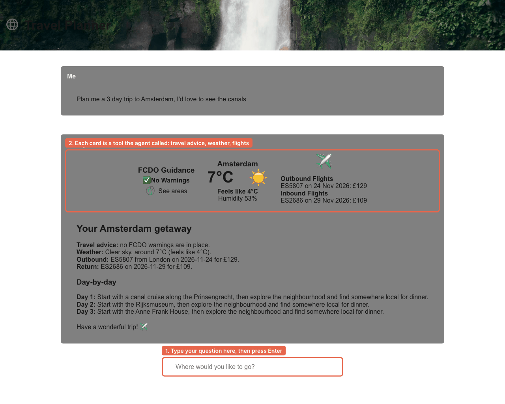
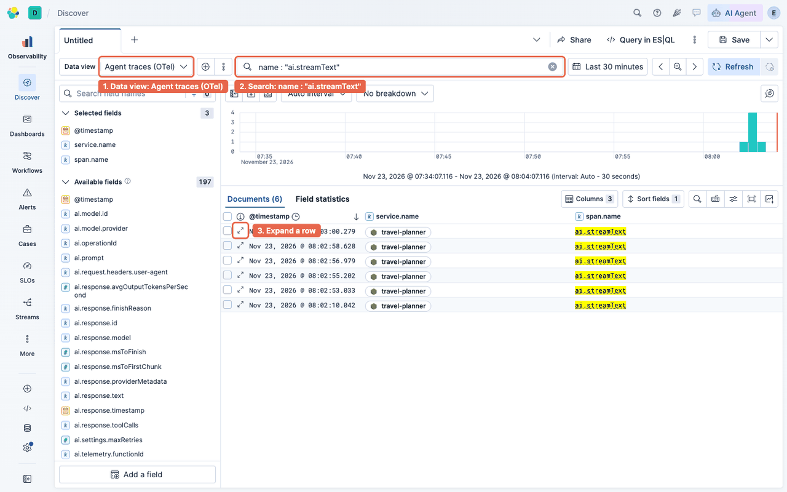
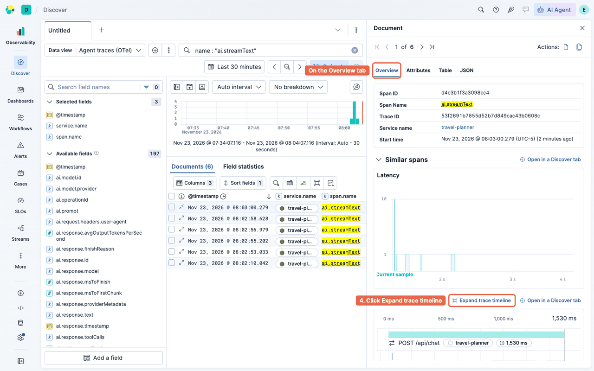
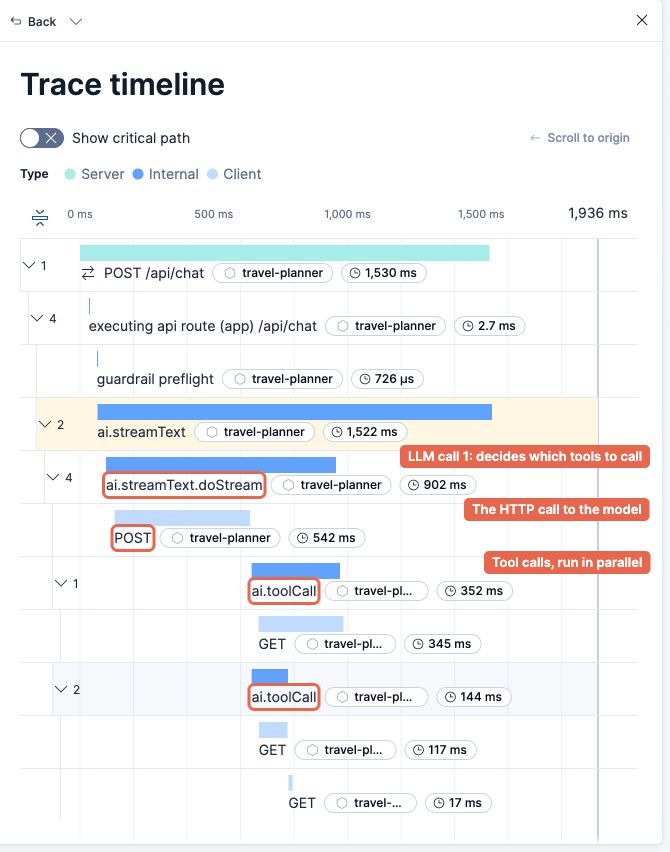
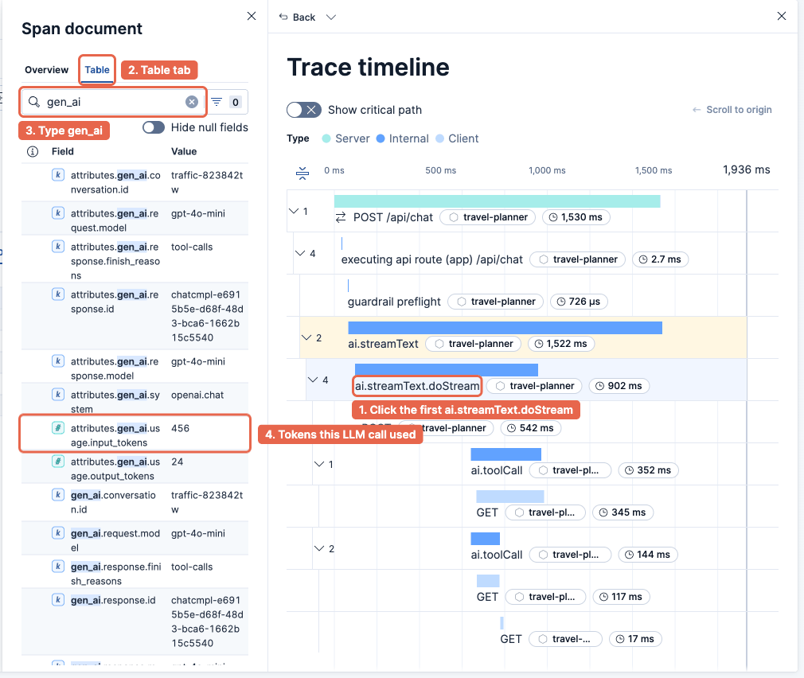
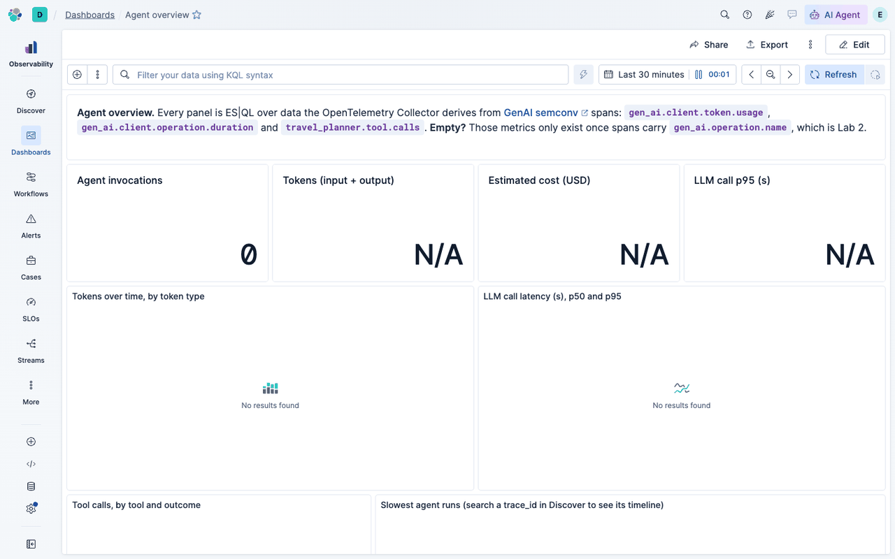

# Lab 1: see what your agent does (8 minutes)

**Goal:** follow one request through the agent, from the HTTP call to every LLM call and tool call, and find where the tokens went.

Pairs: the **driver** types, the **navigator** reads this page and keeps time. Swap at the next lab.

## 1. Use the agent

1. Open the travel planner at <http://localhost:3000>.
2. Ask: `Plan me a 3 day trip to Amsterdam, I'd love to see the canals`. Cards appear for the travel advice, the weather and the flights: each one is a tool the agent called.

   
3. Ask something it should refuse: `What do you think about the next election?`
4. In a terminal, send a batch of test prompts so you have more to look at:

   ```bash
   make traffic
   ```

## 2. Follow a request through the trace

1. Open Kibana at <http://localhost:5601> (user `elastic`, password `changeme`) and go to **Discover**. Close any welcome or survey pop-up.
2. Pick the **Agent traces (OTel)** data view (top left) and search for `name : "ai.streamText"`.

   

3. Expand a row (the ⤢ icon at the start of the row). In the flyout, on the **Overview** tab, click **Expand trace timeline**.

   

You're looking at one request to the agent:

```
POST /api/chat                          the HTTP request
└─ executing api route (app) /api/chat
   ├─ guardrail preflight               our input checks
   ├─ ai.streamText                     the agent
   │  ├─ ai.streamText.doStream         LLM call 1: decides which tools to call
   │  │  ├─ POST                        ─ the HTTP call to the LLM
   │  │  ├─ ai.toolCall                 ┐ the three tools, called in parallel:
   │  │  ├─ ai.toolCall                 │ fcdo (GET gov.uk), weather (2 × GET open-meteo.com)
   │  │  └─ ai.toolCall                 ┘ and flights (msearch: Elasticsearch)
   │  └─ ai.streamText.doStream         LLM call 2: writes the itinerary
   ├─ guardrail postflight              our output checks
   └─ ai.generateText                   LLM-as-a-judge grades the answer
```



4. Compare the bars. The `POST` under each `ai.streamText.doStream` is the call to the LLM itself. Which part of the request is slow: the LLM calls or the tools?
5. Click the first `ai.streamText.doStream` span. In the flyout, open the **Table** tab and type `gen_ai` in the search box. (Each field shows up twice, with and without `attributes.` in front: same value.) Find:
   - the token counts: `gen_ai.usage.input_tokens` and `gen_ai.usage.output_tokens`
   - the model: `gen_ai.request.model`
   - the provider: `gen_ai.system`. This attribute is **deprecated** in the current semantic conventions.

   

6. Now search for `ai.prompt.messages`: the full prompt, including the system prompt. Think about what that means for privacy.
7. The three tool spans are all called `ai.toolCall`. Click each one and search its **Table** for `ai.toolCall.name` to see which tool it is.

## 3. Open the dashboard

Go to **Dashboards > Agent overview**. It's empty: the numbers say 0 or N/A, and the charts say "No results".



Every panel is built from `gen_ai.client.token.usage` and its relatives, which the collector derives from spans that carry `gen_ai.operation.name`. The agent doesn't emit that attribute: it uses the AI SDK's own `ai.*` names. That's Lab 2.

## You're done when

- you can name the three tools the agent called, and say which one was slowest
- you know how many input tokens the first LLM call used
- you can explain why **Agent overview** is empty

## Talk about it

- Every framework names things differently: Vercel AI SDK `ai.*`, OpenInference `llm.*`, OpenLLMetry `traceloop.*`. What happens to your dashboards when a team adopts a second framework?
- The prompt and the answer are in the trace. Who should be able to read them?
