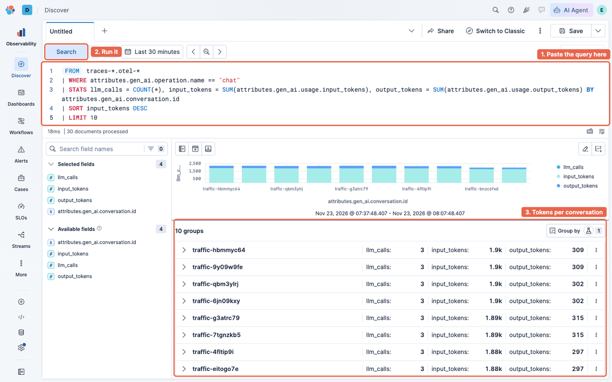
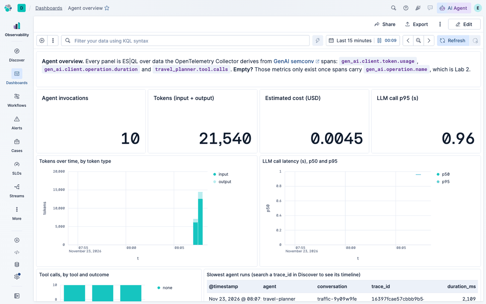

# Lab 2: normalize and measure (9 minutes)

**Goal:** turn the agent's vendor-specific telemetry into the [OpenTelemetry GenAI semantic conventions](https://opentelemetry.io/docs/specs/semconv/gen-ai/) in the collector, without touching the app, and watch token and latency metrics appear.

Swap driver and navigator.

## 1. Add the GenAI normalizer to the collector

Open `infra/otel-collector/config.yaml` and find `LAB 2 TODO`. The collector ships with the contrib [`gen_ai_normalizer`](https://github.com/open-telemetry/opentelemetry-collector-contrib/tree/main/processor/genainormalizerprocessor) processor. It has built-in sources for OpenInference and OpenLLMetry. For the AI SDK's legacy `ai.*` shape, you write your own source:

1. Uncomment the `gen_ai_normalizer:` block. Keep its indentation: it sits under `processors:`.
2. Fill in the four TODOs. You'll need the [GenAI span conventions](https://opentelemetry.io/docs/specs/semconv/gen-ai/gen-ai-spans/) and the attributes you found in Lab 1.
3. Add `gen_ai_normalizer` to the end of the **traces** pipeline's `processors:` list near the bottom of the file.
4. Apply it:

   ```bash
   make collector-restart
   make traffic
   ```

   If the restart fails, run `docker compose logs otel-collector | tail -20`: it names the line it didn't like.

<details>
<summary>Stuck? The answers</summary>

```yaml
mappings:
  gen_ai.system: gen_ai.provider.name     # TODO 1
  ai.toolCall.name: gen_ai.tool.name      # TODO 2
value_mappings:
  gen_ai.operation.name:
    ai.streamText.doStream: chat          # TODO 3
    ai.generateText.doGenerate: chat
    ai.toolCall: execute_tool             # TODO 4
```

Or apply the full solution: `make solution LAB=2`.
</details>

## 2. Check the spans

In **Discover**, click **Query in ES|QL**, paste this query and run it. It counts the spans that follow the GenAI semantic conventions, which was zero in Lab 1. `SET unmapped_fields="nullify"` keeps the query working on a stack where no span has carried `gen_ai.operation.name` yet.

```esql
SET unmapped_fields="nullify";
FROM traces-*.otel-*
| WHERE resource.attributes.service.name == "travel-planner" AND @timestamp > NOW() - 5 minutes
| STATS semconv_spans = COUNT(attributes.gen_ai.operation.name), all_spans = COUNT(*)
```

`semconv_spans` should now be above zero. Now you can ask questions in a framework-neutral way:

```esql
FROM traces-*.otel-*
| WHERE attributes.gen_ai.operation.name == "chat"
| STATS llm_calls = COUNT(*), input_tokens = SUM(attributes.gen_ai.usage.input_tokens), output_tokens = SUM(attributes.gen_ai.usage.output_tokens) BY attributes.gen_ai.conversation.id
| SORT input_tokens DESC
| LIMIT 10
```



If the editor shows "1 error: Unknown column" under a query that returned results, ignore it: the editor's field list is a few minutes behind. Reloading the page clears it.

## 3. Watch the metrics appear

Open **Dashboards > Agent overview** (it refreshes every 10 seconds). No one wrote metrics code: the collector's `signal_to_metrics` connector builds `gen_ai.client.token.usage` and `gen_ai.client.operation.duration` from the `chat` spans, using the bucket boundaries the semantic conventions recommend.



## Stretch goals

- **PromQL.** The same metrics also go to Prometheus. Open <http://localhost:9090>, query `gen_ai_client_token_usage_sum`, and notice how the name changed. Prometheus remote-writes everything into Elasticsearch, so you can run PromQL from Kibana too. In Discover's ES|QL editor:

  ```promql
  PROMQL index=metrics-generic.prometheus-* step=1m sum by (gen_ai_token_type) (increase(gen_ai_client_token_usage_sum[5m]))
  ```

- **Native semantic conventions.** The AI SDK can also emit the conventions itself. Run `make semconv`, then `make traffic`, and open a new trace. The spans are now `invoke_agent travel-planner` > `step 1` > `chat gpt-4o-mini` and `execute_tool weather`, and the LLM calls are `CLIENT` spans. The dashboard doesn't change, and that's the point: one schema, whatever produced it. Run `make legacy` before Lab 3.
- **Semconv span names.** The normalizer only rewrites attributes. Uncomment `transform/genai_span_names` (the `LAB 2 STRETCH` block) and add it after `gen_ai_normalizer` in the traces pipeline, so legacy spans are named like native ones.
- **Cost.** Cost isn't in the semantic conventions. Run the cost query in [`queries/README.md`](../queries/README.md) and change the prices.

## You're done when

- **Agent overview** shows tokens, latency and tool calls
- your ES|QL query lists token usage per conversation

## Talk about it

- Normalizing in the collector fixes every app at once, but only for the shapes you map. Fixing it at the source (the first stretch goal) is cleaner. When would you pick each?
- `gen_ai.provider.name` used to be `gen_ai.system`. The GenAI conventions are still in development. How do you keep dashboards working while they change?
