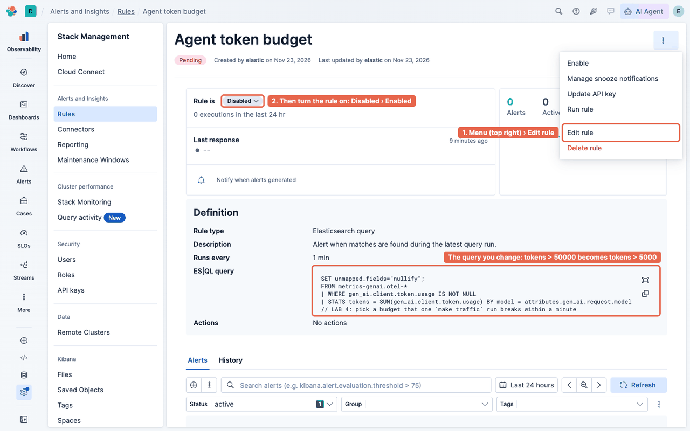
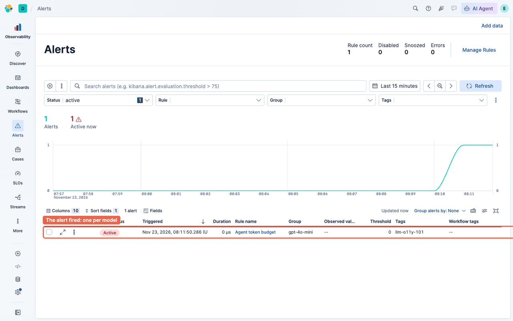

# Lab 4: keep it (6 minutes)

**Goal:** leave with an alert that fires and a dashboard you can take home.

Swap driver and navigator.

## 1. Alert on a token budget

A runaway agent loop can burn through a budget in minutes. A rule is waiting for you, switched off. Every minute, it adds up the tokens each model used in the last minute.

1. Go to **Alerts > Manage rules** and open **Agent token budget**.
2. Open the **⋮** menu (top right) and choose **Edit rule**. In the ES|QL query, change `tokens > 50000` to a budget that one `make traffic` run will break: `tokens > 5000`.

   

3. Click **Test query**. It should match nothing. If it matches, that's your red-team traffic from Lab 3 still inside the one-minute window: wait a minute and test again. Then click **Save rule**.
4. Turn the rule on: click **Disabled** next to "Rule is" and choose **Enabled**.
5. Run:

   ```bash
   make traffic
   ```

6. While you wait, run `make export` (section 2). Within about two minutes the rule fires and the alert shows up in **Alerts**. Open it: there's one alert per model (in mock mode, just `gpt-4o-mini`). Its reason names the model; the "document count" in it is the number of rows the query returned, not tokens. To see the token total, run the rule's query in Discover.

   

## 2. Take it home

```bash
make export
```

This writes your dashboards to `my-agent-dashboard.ndjson`. You can import the file into any Kibana 9.5 or later, including Elastic Cloud: **Stack Management > Saved objects > Import**. Every panel uses the OpenTelemetry GenAI semantic conventions, so it works for any agent that follows them, not just this one.

## 3. Make the dashboard yours (if you have time)

1. Open **Dashboards > Agent overview** and click **Edit** (skip this if you already see **Exit edit**).
2. Click **Add**, then **Visualization (query)**. Replace the query with one from [`queries/README.md`](../queries/README.md) and run it. Good choices:
   - tokens per conversation: which users are expensive?
   - p95 LLM latency with PromQL
   - hallucinations with the judge's explanation
3. Pick a chart type, then click **Apply and close**.
4. To give the panel a title, hover over it, click the gear icon (**Settings**), fill in **Title** and click **Apply**. Then **Save** the dashboard.

## You're done when

- the **Agent token budget** alert has fired
- `my-agent-dashboard.ndjson` exists
- (if you had time) your dashboard has a panel you added. Run `make export` again afterwards to take it with you

## Taking this to production

- **Send the data somewhere real.** Point the collector's `elasticsearch` exporter at Elastic Cloud, or send OTLP to Elastic's managed OTLP endpoint and skip the collector.
- **Normalize once for a mixed fleet.** One collector can map OpenInference, OpenLLMetry and the AI SDK's legacy shape into one schema, so every team's agent shows up on the same dashboards.
- **Watch the conventions.** The GenAI semantic conventions are still in development: pin versions and keep the normalizer in the collector, where one change fixes every app.
